# MLOps POC — GitOps model delivery on a laptop

A complete, local MLOps platform that runs on a MacBook (Apple Silicon, 32 GB). It trains a loan-default model, tracks and registers it in MLflow, gates promotion on a fixed holdout set, and deploys it through Git with ArgoCD. Argo Rollouts then runs a **canary release that rolls back automatically** when Prometheus sees errors.

It uses the same stack as production work: Terraform, Kubernetes, Helm, ArgoCD, Argo Rollouts, MLflow, Prometheus, Grafana, GitHub Actions with Trivy and Checkov, plus an optional LiteLLM gateway for local LLMs.

## Architecture

```mermaid
flowchart LR
  subgraph Mac["Your Mac"]
    dev["make train / promote"] -->|log runs, register models| mlflow
    dev -->|"modelVersion in values.yaml"| git[(GitHub repo)]
    ollama["Ollama (optional, Metal GPU)"]
  end

  subgraph kind["kind cluster (created by Terraform)"]
    argocd[ArgoCD] -->|syncs| mlflow[MLflow server]
    argocd -->|syncs| rollout[model-api Rollout]
    argocd -->|syncs| prom[Prometheus + Grafana]
    argocd -->|syncs| ar[Argo Rollouts]
    rollout -->|loads exact model version| mlflow
    prom -->|scrapes /metrics| rollout
    ar -->|canary analysis query| prom
    ar -->|promote or abort| rollout
    litellm["LiteLLM gateway (optional)"] --> ollama
  end

  git -->|watched by| argocd
  ci[GitHub Actions: tests, Trivy, Checkov] --> git
```



The key design choice is that **Git decides which model runs**. The API loads `models:/loan-default/<modelVersion>`, and `modelVersion` lives in `gitops/model-api/values.yaml`. Promoting a model is a Git commit, so every deployment is reviewed, audited and reversible with `git revert`.

## What each part shows

| Area | Where | What it demonstrates |
| --- | --- | --- |
| IaC | `infra/terraform` | kind cluster, ArgoCD and app-of-apps root, all in Terraform |
| GitOps | `gitops/apps` | ArgoCD app-of-apps; everything after ArgoCD comes from Git |
| ML pipeline | `ml/pipeline.py` | ingest → validate → train → evaluate on fixed holdout → register |
| Promotion gate | `ml/promote.py` | champion/challenger comparison; MLflow alias + Git values update |
| Serving | `serving/app/main.py` | FastAPI, readiness gated on model load, Prometheus metrics |
| Progressive delivery | `gitops/model-api/templates` | Argo Rollouts canary with Prometheus-based automated rollback |
| Observability | dashboard + PrometheusRule | traffic and errors by revision, latency, prediction-drift signal |
| DevSecOps | `.github/workflows/ci.yml`, pod specs | tests, Trivy, Checkov, non-root, read-only filesystem, dropped capabilities |
| AI gateway | `gitops/optional/litellm` | LiteLLM in front of local Ollama models, fallbacks, Langfuse hook |

## 1. Prerequisites

Install the tools:

```bash
brew install kind kubectl helm python@3.12 git
brew tap hashicorp/tap && brew install hashicorp/tap/terraform
brew install argoproj/tap/kubectl-argo-rollouts   # to watch canaries
brew install trivy checkov                        # optional: local security scans
```

Install **Docker Desktop** or **OrbStack**, and give it at least **6 CPUs and 12 GB of memory**. The full stack uses about 6–8 GB, so a 32 GB MacBook Air has plenty of headroom.

Check everything with `make prereqs`.

## 2. Put the project in your own Git repo

ArgoCD pulls from Git, so it needs a repo it can read. A **public** GitHub repo is simplest (a private repo needs ArgoCD repository credentials).

```bash
cd mlops-poc
git init -b main
gh repo create mlops-poc --public --source=. --push   # or create it on github.com and push
make configure REPO=https://github.com/<you>/mlops-poc
git add -A && git commit -m "configure repo URL" && git push
```

## 3. Start the platform

```bash
make bootstrap
```

This runs Terraform (kind cluster, ArgoCD, root app), builds both images and loads them into kind, creates the Python venv, and waits for MLflow. The first run takes about 10 minutes, mostly image downloads.

```bash
make urls        # all local URLs
make passwords   # ArgoCD admin password
make status
```

| Service | URL | Login |
| --- | --- | --- |
| ArgoCD | http://localhost:8080 | admin / `make passwords` |
| MLflow | http://localhost:5050 | none |
| Model API | http://localhost:8800/docs | none |
| Grafana | http://localhost:3000 | admin / admin |
| Prometheus | http://localhost:9090 | none |

At this point the model-api pods are running but **not Ready**: no model exists yet. This is intended, because readiness only passes once the model is loaded.

## 4. Demo scenarios

### A. First model to production

```bash
make train       # v1: roc_auc ≈ 0.768
make promote     # no champion yet → v1 becomes champion; values.yaml already says "1"
```

Within about 10 seconds the pods load v1 and turn Ready. Try a prediction at http://localhost:8800/docs.

### B. Promotion gate rejects a weaker model

```bash
make train ARGS="--algo logreg"   # v2: roc_auc ≈ 0.763
make promote                      # REJECTED: does not beat v1
```

Every run is scored on the same fixed holdout set (`HOLDOUT_SEED` in `pipeline.py`), so the comparison is fair. Open MLflow and compare the runs side by side.

### C. Better model via canary release

Open a second terminal and keep traffic flowing, because the canary analysis needs real requests:

```bash
make load
```

Then train a stronger challenger, promote it and release it through Git:

```bash
make train ARGS="--rows 60000 --n-estimators 300 --learning-rate 0.05"   # v3: roc_auc ≈ 0.773
make promote                       # PROMOTED: v3 is champion, values.yaml now "3"
make release MSG="promote model v3"
make sync                          # skip ArgoCD's 3-minute poll
make watch
```

The rollout goes 25% → analysis → 50% → 100%. In the load terminal you'll see the version mix shift from v1 to v3. In Grafana, open **Model API – loan-default** to see traffic move between pod revisions.

### D. Bad release is rolled back automatically

```bash
make chaos-on                      # next release fails 30% of requests
make release MSG="bad release"
make sync && make watch
```

At 25%, the canary's error rate goes above the 5% limit, the analysis fails, and Argo Rollouts **aborts and sends all traffic back to the stable version**, with no human involved. The Grafana "Error rate by pod revision" panel shows the spike on the canary only. Recover with:

```bash
make chaos-off && make release MSG="remove chaos" && make sync
```

### E. Roll back a model on purpose

```bash
cd ml && ../.venv/bin/python promote.py --version 1 --force && cd ..
make release MSG="rollback to model v1" && make sync
```

Or simply `git revert` the promotion commit. Either way, the rollback is a reviewed Git change.

### F. Optional: AI gateway with local LLMs

```bash
brew install ollama && ollama serve &          # runs on the Mac's GPU (Metal)
ollama pull llama3.2 && ollama pull qwen2.5:7b
cp gitops/optional/litellm/application.yaml gitops/apps/
git add -A && git commit -m "enable LiteLLM gateway" && git push && make sync
```

```bash
curl http://localhost:4000/v1/chat/completions \
  -H "Authorization: Bearer sk-local-dev-only" -H "Content-Type: application/json" \
  -d '{"model":"llama3.2","messages":[{"role":"user","content":"Explain a canary release in one sentence."}]}'
```

For **Langfuse** tracing, run Langfuse with its official Docker Compose on another port (for example 3001, since Grafana uses 3000), add the `LANGFUSE_*` variables to the LiteLLM deployment, and uncomment the callbacks in `config.yaml`. Colima users should replace `host.docker.internal` with `host.lima.internal`.

## 5. Day-to-day commands

```bash
make help    # all targets
make test    # unit tests: data validation + API
make lint    # ruff, terraform fmt, helm lint
make scan    # Trivy image scan + Checkov on Terraform and Kubernetes manifests
make down    # destroy the cluster
```

## 6. CI pipeline

`.github/workflows/ci.yml` runs on every push and PR: ruff and pytest; Terraform fmt and validate; Helm lint and render; Checkov (report-only in this POC); a Docker build; a Trivy scan that blocks fixable HIGH and CRITICAL CVEs; and a push to GHCR on `main`.

The local flow uses `kind load` instead of a registry, so it works offline and with native arm64 images.

## Troubleshooting

**An app is stuck "OutOfSync" or failing on first sync.** The Rollout and ServiceMonitor CRDs arrive from other apps. Retries are configured, so wait a couple of minutes or run `make sync`.

**`ErrImageNeverPull` or `ErrImagePull` for `mlops-poc/...` images.** Run `make images` again. Images must be loaded into kind after every cluster rebuild.

**model-api never becomes Ready.** Check that the version in `values.yaml` exists in MLflow, then run `kubectl logs -n model-api -l app.kubernetes.io/name=model-api`.

**ArgoCD shows "repository not accessible".** The repo is private, or `make configure` wasn't committed and pushed.

**Port already in use.** Change the host port in `infra/terraform/variables.tf` (`port_mappings`). MLflow uses 5050 because macOS AirPlay Receiver takes port 5000.

**A Helm chart version is not found.** The chart versions are pinned. Find current ones with `helm search repo <chart> --versions` and update `variables.tf` or `gitops/apps/*.yaml`.

**Version gotcha.** MLflow 2.17 breaks with SQLAlchemy 2.1+, so it's pinned to 2.0.36 everywhere. The scikit-learn version must match between training and serving, or saved models may fail to load.

## Ideas to extend it

- OPA Gatekeeper policies (non-root, resource limits, allowed registries) as another ArgoCD app.
- KEDA autoscaling the model API on request rate.
- Feature drift check: compare live inputs with `data/feature_baseline.json` logged on every run.
- Kubeflow Pipelines or Argo Workflows to run `pipeline.py` inside the cluster on a schedule.
- External Secrets Operator with a local Vault instead of the plain LiteLLM Secret.
- A GitLab CI version of the pipeline.
